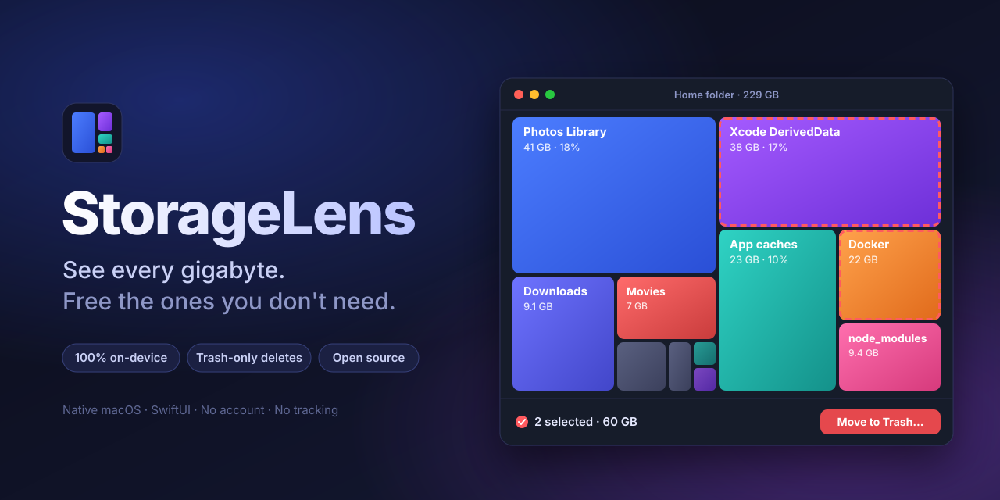
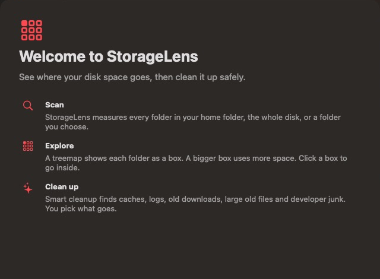
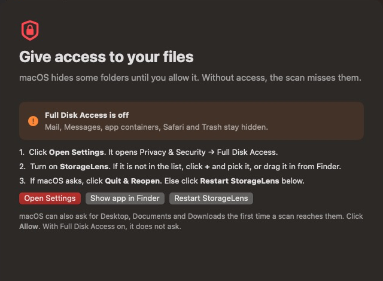
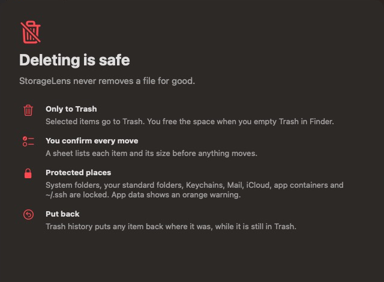
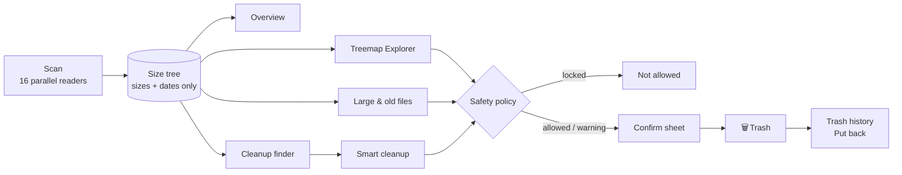

<p align="center">
  
</p>

<h3 align="center">Your Mac says “Storage almost full.”<br>StorageLens shows you <em>exactly</em> why — and gets it back, safely.</h3>

<p align="center">
  <a href="#-install-in-60-seconds"></a>
  <a href="#requirements"></a>
  <a href="#-privacy"></a>
  <a href="LICENSE"></a>
</p>

<p align="center">
  <a href="#-install-in-60-seconds"><b>Install</b></a> ·
  <a href="#-what-you-get"><b>Features</b></a> ·
  <a href="#-how-it-works"><b>How it works</b></a> ·
  <a href="#-built-to-never-break-your-mac"><b>Safety</b></a> ·
  <a href="#-faq"><b>FAQ</b></a>
</p>

---

## The problem

You bought a 500 GB Mac. Now 14 GB are free, and **System Settings** shows a grey bar called *System Data* that nobody can explain.

The usual fix is a mix of `du -sh *` in Terminal, Get Info in Finder, and hope. Or a paid "cleaner" that asks for your trust and deletes things you cannot get back.

**StorageLens is the other way.** One scan. Every folder as a box you can see. A cleanup list that knows the difference between junk and your work. And a hard rule: **nothing is ever deleted — it goes to Trash, and you can put it back.**

> On the author's Mac, the first scan mapped **2.36 million files (229 GB) in about 2½ minutes** and found **49 GB of developer junk, 23 GB of app caches and 9 GB of forgotten downloads.**

---

## ✨ What you get

<table>
  <tr>
    <td width="33%" valign="top">
      <h3>🗺️ The map</h3>
      A <b>treemap</b> of your disk: every folder is a box, and a bigger box uses more space. Click to go inside. The sorted list next to it gives exact sizes.
    </td>
    <td width="33%" valign="top">
      <h3>🧹 Smart cleanup</h3>
      Finds what is safe to remove: <b>Xcode DerivedData, simulators, npm / pnpm / Yarn / pip / Gradle / CocoaPods / Homebrew caches, <code>node_modules</code></b>, app caches, logs and old downloads.
    </td>
    <td width="33%" valign="top">
      <h3>📦 Large &amp; old files</h3>
      Every file over 50 MB, 1 GB or 5 GB, filtered by <b>“not used for 90 days”</b>. The forgotten 12 GB screen recording is here.
    </td>
  </tr>
  <tr>
    <td valign="top">
      <h3>🛟 Trash-only deletes</h3>
      Every clean-up goes to <b>Trash</b>, after a confirm sheet that lists each item and its size. <b>Put back</b> undoes it in one click.
    </td>
    <td valign="top">
      <h3>🔒 Guard rails</h3>
      A built-in safety policy <b>locks</b> system folders, Keychains, Mail, iCloud, app containers and <code>~/.ssh</code>. App data gets an orange warning.
    </td>
    <td valign="top">
      <h3>⚡ Fast &amp; native</h3>
      Pure Swift and SwiftUI. 16 parallel readers, low memory, cloud drives skipped by default so a scan never stalls.
    </td>
  </tr>
</table>

---

## 👋 A first launch that explains itself

The welcome guide shows what the app does, sets up permissions, and states the safety rules **before** the first scan. Open it again any time from **Help → Welcome Guide**.

<table>
  <tr>
    <td width="33%"></td>
    <td width="33%"></td>
    <td width="33%"></td>
  </tr>
  <tr>
    <td align="center"><b>What it does</b></td>
    <td align="center"><b>Permissions, with a live status</b></td>
    <td align="center"><b>The safety promise</b></td>
  </tr>
</table>

---

## 🚀 Install in 60 seconds

### Requirements

| | |
|---|---|
| 🖥️ **macOS** | 14 Sonoma or later (Apple silicon or Intel) |
| 🛠️ **Swift** | 5.10 or later — from **Xcode 15.3+** or the free **Command Line Tools** |
| 💾 **Space** | About 200 MB for the build |

No Swift yet? One command installs it:

```bash
xcode-select --install
```

### Build and install

```bash
git clone https://github.com/yehiabairm/StorageLens.git
cd StorageLens
zsh scripts/build-app.sh --install
open ~/Applications/StorageLens.app
```

That's it. The app is in `~/Applications`, and the welcome guide opens.

<details>
<summary><b>Why build from source and not download a .dmg?</b></summary>
<br>
StorageLens is not signed with a paid Apple Developer ID yet. The build script signs it on your Mac ("ad-hoc"), and macOS trusts an app that you built yourself, so Gatekeeper does not block it. You also get to read every line before it touches your disk.
</details>

<details>
<summary><b>Update · Uninstall</b></summary>
<br>

**Update:**

```bash
cd StorageLens && git pull && zsh scripts/build-app.sh --install
```

A new build has a new local signature, so macOS can ask for Full Disk Access again.

**Uninstall:** drag `~/Applications/StorageLens.app` to Trash. To also remove its settings and Trash history:

```bash
defaults delete dev.beram.StorageLens
```
</details>

---

## 🔑 Permissions

StorageLens needs to **read** folders to measure them, and to **move items to Trash** to clean them. That's all.

| Permission | Why | How |
|---|---|---|
| **Full Disk Access** *(recommended)* | Without it, macOS hides Mail, Messages, Safari, app containers and Trash, and your totals look too small. | The welcome guide has an **Open Settings** button → turn on StorageLens → **Restart StorageLens**. |
| **Desktop · Documents · Downloads** | Only when Full Disk Access is off. macOS asks once per folder. | Click **Allow**. |

> **Why not sandboxed?** A sandboxed app cannot measure your whole disk or move files outside its own box. That is also why StorageLens is not in the App Store.

---

## 🧠 How it works



- **Sizes, not contents.** The scan asks macOS for each file's allocated size and dates. It never opens a file.
- **Small stays small.** Files under 1 MB in a folder become one "small files" box, so a 2-million-file scan fits in a few hundred MB of memory.
- **Cloud drives are skipped by default.** iCloud Drive and Google Drive files are mostly online-only, use no local space, and answer one folder at a time. Turn them on from the Scan menu: *Include iCloud and cloud drives (slow)*.
- **No volume hopping.** The scan stays on one disk. It does not cross into external drives or network shares.

---

## 🛡️ Built to never break your Mac

| Rule | What it means |
|---|---|
| **Trash, never delete** | Items move to Trash with `FileManager.trashItem`. Space comes back when *you* empty Trash. |
| **You confirm every move** | A sheet lists each item, its size and any warning before anything moves. |
| **Locked places** | System locations, your home folder and its standard folders, `~/Library` itself, Keychains, Mail, Messages, iCloud, app containers, `~/.ssh` and files inside an `.app`. |
| **Orange warnings** | App data in `~/Library/Application Support` and apps in `/Applications`. |
| **Smart about dev tools** | Global tools in `…/lib/node_modules` (npm, nvm, Homebrew) are never called junk. |
| **Report-only items** | Simulators and Docker show the right command (`xcrun simctl delete unavailable`, `docker system prune -a`) and are not touched. |
| **Put back** | Trash history returns any item to where it was, while it is still in Trash. |

---

## 🔐 Privacy

- **No network.** StorageLens makes no network calls.
- **No account, no analytics, no telemetry.**
- **Your data stays local.** The only thing it saves is its settings and Trash history, in macOS user defaults.

---

## ❓ FAQ

<details>
<summary><b>What is "System, apps, other users, snapshots" in the disk bar?</b></summary>
<br>
Space the scan does not cover: macOS itself, apps, other users, swap files and Time Machine local snapshots. Scan the <b>Whole disk</b> from the Scan menu to see more of it. macOS also shows <b>purgeable</b> space, which it frees by itself when it needs room.
</details>

<details>
<summary><b>I moved 30 GB to Trash, but free space did not change.</b></summary>
<br>
That's the safety rule. Empty Trash in Finder to get the space back.
</details>

<details>
<summary><b>Can it delete something important?</b></summary>
<br>
It can only move items to Trash, and the safety policy locks the places that hold your system, your keys and your accounts. You confirm each move, and Put back undoes it.
</details>

<details>
<summary><b>Why is a folder shown with a lock?</b></summary>
<br>
The safety policy protects it. Hover the lock to see why.
</details>

---

## 🗺️ Roadmap ideas

- [ ] Menu bar widget with free space and a one-click scan
- [ ] Duplicate file finder
- [ ] Scheduled scans with a "you grew 10 GB this week" note
- [ ] Signed and notarized `.dmg` download

Ideas and pull requests are welcome.

---

## 🧑‍💻 Develop

```bash
swift build   # debug build
swift test    # core tests: scanner, treemap, safety rules, Trash and Put back
```

| Folder | Contents |
|---|---|
| `Sources/StorageLensCore` | Scanner, treemap layout, safety policy, cleanup finder, Trash service. No UI. |
| `Sources/StorageLens` | The SwiftUI app and the welcome guide. |
| `Tests/StorageLensCoreTests` | Unit tests for the core. |
| `scripts/build-app.sh` | Builds, signs and (with `--install`) installs the app. |
| `scripts/make-icon.swift` | Draws the app icon. |

<p align="center"><sub>MIT licensed · Made on a Mac that was almost full.</sub></p>
